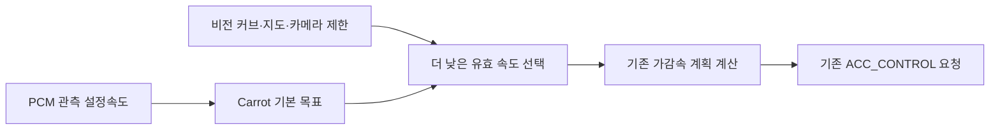

# RAV4 2022 PCM 모드0 입력 연동

## 결과

RAV4 TSS2 2022의 기존 직접 종방향 제어에서 관측된 순정 PCM 설정속도 변경·첫 SET·RES 재개를 Carrot의 기본 목표속도에 연결했다. 커브·지도·카메라 제한속도는 기존 하위 처리에서 계속 더 낮은 값을 적용한다.

사용자의 추가 요청은 확인 질문에서 “기존 직접 종방향 제어에서 버튼 입력·연동 문제 수정”으로 구체화되었고, 이후 코너·지도 감속 유지가 추가되었다. 이를 위해 기존 `ACC_CONTROL` 직접 가감속 경로의 입력을 수정했다. 검증되지 않은 RES/SET CAN 요청을 정의하거나 차량에 전송하지 않았다.

실제 전체 `VCruiseCarrot`에서 기본값83km/h가 비활성·미설정 PCM0 → 첫 SET60 → 유지60 → 조정61에 따라83 → 60 → 60 → 61로 바뀌는 것을 직접 확인했다. 순정 속도75를 비활성 상태에서 관측하고 재개한 뒤74·80으로 바꾸면 기본값도75·74·80으로 바뀐다.

코너55·지도45·카메라30km/h 제한과 오래된 내비 입력 해제는 원본 planner 메서드와 실제 내비 입력 검사 함수의 수치 실행으로 검증했다. 이 시험은 전체 가감속 계산기·차량 동작 검증이 아니다.

## 확인한 원인과 구현

Toyota의 RES/SET은 기본 CarState의 속도 버튼 이벤트로 만들어지지 않는다. 기존 `cruise.py`는 모드1과 Toyota 모드3에서만 PCM 설정속도를 읽고, 모드0에서는 이전 Carrot 기본값을 유지한다. 실제 `VCruiseCarrot`에 순정 설정속도75 → 74 → 80을 넣어도 모드0의 값은83 → 83 → 83으로 남는 것을 재현했다.

새 `ToyotaPcmSetSpeedSync`는 다음 조건을 모두 만족할 때만 관측한다.

- 정확한 `TOYOTA_RAV4_TSS2_2022`, Toyota, PCM 크루즈, 이미 허용된 직접 종방향 제어, `SpeedFromPCM=0`.
- 유효 CAN·크루즈 사용 가능 상태, 유한하고 양수인 설정속도.
- 확인한 비활성→활성 전이 또는 PCM 설정속도0.5km/h 이상 변화.

순정 값이 그대로이면 Carrot·Bluetooth의 목표를 덮어쓰지 않는다. 같은 프레임에 로컬 입력이 바뀌면 그 입력을 우선하고, PCM 관측 기준은 갱신하여 다음 프레임에 뒤늦게 덮어쓰지 않는다. 비활성 PCM0은 미설정 상태이며 숫자 목표0으로 적용하지 않는다. 최초부터 활성인 표본은 기준만 저장해 모드 전환 자체로 목표를 바꾸지 않는다.

NaN·0·255·범위 초과·잘못된 CAN·모드 변경에서는 관측을 초기화한다. 실제 Cap’n Proto Float32로 저장한145km/h의 미세한 변환 오차는0.001km/h 단위로 정규화하고,145.001·146·255는 수용하지 않는다. 잘못된 계기판 설정속도는 유효 기본속도로 대체한다. 기존 속도 클립 정책을 유지한다.

다른 차종·모드1/2/3·순정 롱컨의 동작은 적용 조건에서 제외한다. 이 값으로 `CarParams.openpilotLongitudinalControl`, 레이더 플래그, Panda 안전 플래그나 실제 설정을 활성화하지 않는다.

변경 소스는 `openpilot/selfdrive/car/toyota_pcm_speed.py`, `openpilot/selfdrive/car/cruise.py`, 새 테스트 파일이다. 소스 변경이 곧 장치 적용이라는 뜻은 아니다.

## 코너·지도 제한 전달

소스에 기존 감속 연결은 이미 있다.

`carrot_serv.py`는 후보 중 최소 `desiredSpeed`를 만들고, `CarrotPlanner._update_carrot_man()`은 기본 목표를 이 값으로 낮춘다. `longitudinal_planner.py`와 `long_mpc.py`가 제한된 목표를 사용하며, `controlsd.py`의 계산된 가속도를 Toyota `carcontroller.py`가 기존0x343 메시지로 구성한다. 이 처리와 가속도 한계·rate limit을 수정하지 않았다. 기존 eco 정책도 보존하므로 PCM 값은 “기본 목표”이며 모든 상황의 절대 상한으로 새로 정의하지 않았다.

모드0 HUD의30km/h 표시 하한은 Toyota 직접 가속도 요청의 입력이 아니다. 이를 바꿔 지도 감속을 구현했다는 설명은 잘못이다.

`SpeedFromPCM`과 `TurnSpeedControlMode`는 독립이다. 현재 코드에서1·2는 비전 커브 후보를 사용하고,2는 회전 근거리 범위에서 지도 route 후보도 넣는다.3·4는 지도 후보를 사용한다. 소스 수정만으로 실제 사용자 설정·지도 연결을 바꾸지 않았다.

## 첨부 로그가 보여주는 한계

허용된 설정 항목과 제어 상태만 별도 도구로 추출했다.

| 파일 | PCM 모드 | 커브 선택 모드 | CP 직접 롱컨 | carControl 표본 | 실제 enabled / longActive |
|---|---:|---:|---|---:|---:|
| rlog.zst | 1 | 2 | True | 3,354 | 0 / 0 |
| rlog_06.zst | 3 | 1 | False | 5,997 | 0 / 0 |
| rlog_11.zst | 0 | 1 | CP 없음 | 0 | 자료 없음 |
| rlog_12.zst | 0 | 1 | True | 6,007 | 0 / 0 |

세 주 로그의 순정 설정속도는 각각 한 값뿐이고 버튼 속도 변화가 없다. 모드0의 rlog_12는 vturn308개·road924개 내비 표본과93–200km/h 목표를 기록했지만 제어가 활성화되지 않았다. `road`에는 기본200km/h 제한 없음 상태도 있으므로 이 문구만으로 지도 감속을 입증하지 않았다. 커브 선택 모드1은 지도 route 커브 후보를 추가하지 않는 설정이다.

따라서 첨부 데이터로 “모드0에서 활성화된 직접 롱컨이 커브/지도 감속을 실패했다”는 현장 결함이나 이번 수정 후의 실차 감속 성공을 재현할 수 없다. 이번 입력 단절은 코드 단위로 재현·수정했다.

0x365의 레거시 DBC에는 RES/SET 비트가 있으나 이 RAV4에서 버튼 명령으로 검증된 근거는 없다. ARS510 자료는 같은 주소의 거리·속도 보고 역할을 분석한다. 주소가 같다는 이유로 레거시 버튼 요청을 보내면 안 된다. Panda의 순정 롱컨 허용 목록·0x343 취소 조건을 우회하지 않았다.

## 직접 실행한 검사

최종 한 호출에서 **559 passed, 3.28초, 실패·skip·warning0**을 확인했다.

| 포함 범위 | 개수·결과 |
|---|---|
| ARS510·기존 Toyota·공용 동역학 | 469개 |
| 신규 모드0 입력·상태·제한 회귀 | 52개 |
| 기존 PCM 모드 회귀 | 16개 |
| 기존 비전 커브 처리 회귀 | 22개 |

새 helper·테스트·오프라인 도구 Ruff와 Python compile은 통과했다. 원래 `cruise.py`에 있던 Ruff 오류7개는 이번 범위 밖이며 변경하지 않았다. 레이더 원본 레포의231통과·1생략은 별도 검사로 구분한다.

전체 `VCruiseCarrot`·Bluetooth 버튼 계산은 실제 코드이며 설정·외부 입력 읽기만 메모리로 격리했다. planner 감속 제한은 원본 `_update_carrot_man()`을 추출하여 실제 입력 유효성 검사를 실행했다. 전체 planner/MPC, 장치 native build, Panda 펌웨어, 실차 가감속 검증은 하지 않았다.

다음 검증에는 물리 SET/RES·취소 조작 시각이 표시된 로그와 CAN, `canValid`, PCM 설정속도, `vCruise`, `carrotMan.desiredSpeed`/`desiredSource`, 지도 입력의 유효성·시각, `CC.enabled`/`longActive`, `longitudinalPlan.cruiseTarget`/`aTarget`, 실제0x343 요청을 함께 기록한 자료가 필요하다. PCS/AEB와 기존 안전 코드 검증도 원래 보고서의 미해결 조건으로 남는다.

근거: [원래 PCM 속도 선택](https://github.com/ajouatom/openpilot/blob/0e4ee1bdbef3ad7284b136fddf31592e3f8a785f/openpilot/selfdrive/car/cruise.py#L387), [원래 입력 테스트](https://github.com/ajouatom/openpilot/blob/0e4ee1bdbef3ad7284b136fddf31592e3f8a785f/openpilot/selfdrive/car/tests/test_toyota_pcm_speed.py), [내비·커브 후보](https://github.com/ajouatom/openpilot/blob/0e4ee1bdbef3ad7284b136fddf31592e3f8a785f/openpilot/selfdrive/carrot/carrot_serv.py#L1478), [하위 감속 제한](https://github.com/ajouatom/openpilot/blob/0e4ee1bdbef3ad7284b136fddf31592e3f8a785f/openpilot/selfdrive/carrot/carrot_functions.py#L414), [직접 가감속 메시지](https://github.com/ajouatom/openpilot/blob/0e4ee1bdbef3ad7284b136fddf31592e3f8a785f/opendbc_repo/opendbc/car/toyota/carcontroller.py#L249).
