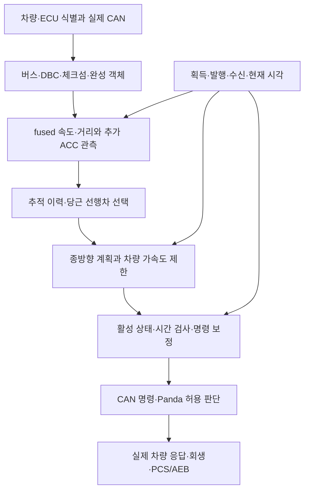

# 증상과 원인을 분리한 검증 기록

2026-10-12. 현재 동결 배포는 `lab-20261012-r4`이며 기준 CarrotPilot은
`0e4ee1bdbef3ad7284b136fddf31592e3f8a785f`이다. 작업은 계속 진행 중이다.

결론: `Vision Only`, 빈 펌웨어 목록, PCM 비활성, 모의 급감속 실패와 처리 지연은 서로 관련될 수 있지만 동일한 원인으로 확정할 수 없다. 각 단계의 입력·판정·출력을 따로 대조했고, 단일 원인 설명을 반박하는 비교 실험을 보존했다. 확인되지 않은 차량 신호나 필터 계수를 임의로 바꾸지 않았다.

## 실제 로그와 활성 주행 가정을 구분

실제 로그에서 직접 확인한 CarControl 15,358개는 모두 종방향 비활성이고, CarState 15,401개도 크루즈 가용·활성 False였다. 기능 설정이 켜져 있어도 이 구간의 제어가 실제 활성화된 것은 아니다. 사용자의 요청에 따라 모의주행·에너지 계산은 롱컨 활성 상태를 가정하되, 이를 실제 로그의 활성 운전 결과로 바꾸어 설명하지 않는다.

## 원인별 근거와 반례

| 문제 또는 설명 | 직접 확인한 근거 | 반례·한계 | 현재 판단 |
|---|---|---|---|
| Vision Only가 단순 표시 문제인가 | 정적 RADAR_ACC 플랫폼 설정에서 radar DBC가 제외되고 radarUnavailable=True가 된다. Toyota의 유효 트랙 모드는 설정값2를 그대로 쓰지 않는다 | 실제 ARS 객체를 오프라인에서 해석해 기존 당근 처리에 전달할 수 있었어도 live 등록·ECU 식별은 별도다 | 현재 코드의 연결 경로 부재가 확인됨. 표시·플래그만 바꾸는 패치는 근거 부족 |
| carFw=0은 조회 실패인가 | 수동 Hybrid 선택과 fixed CP가 관측됐고 현재 원형 get_car→fingerprint에서 skip_fw_query=True·빈FW·송신0을 재현했다 | 과거 차량의 조회 실행 trace는 없음 | 조회 생략으로 설명 가능. 조회 실패나 ECU 미지원으로 확정하지 않음 |
| HYBRID bit가 없어서 모든 감속·회생이 안 되는가 | 빈FW에는 해당 bit가 추가되지 않는다. 현재 gear/GVC/brake 파서 선택은 이 bit와 독립이다 | 실제 Hybrid 동력계·배터리 신호와 회생/마찰 배분은 미확인 | flag를 강제로 넣는 해결책은 입증되지 않음 |
| PCM OFF가 버스 누락·기본값인가 | bus0의 MAIN_ON 4,979개·CRUISE_ACTIVE 4,978개가 DLC·체크섬·기존 Python 파서 검사를 통과했고 모두 False. CarState 15,401개와 0~50ms 자료가 전부 일치했다 | 물리 버튼 의도와 한국형 펌웨어의 실제 bit 의미는 별도 확인 필요 | 제공 구간은 현재 DBC 기준 실제 OFF 관측. 누락·체크섬 거절·default0 설명은 반박됨 |
| 레이더 disable 설정만이 PCM OFF 원인인가 | disable=False인 움직인 로그에서도 같은 OFF가 관측됐다 | 모든 운전 상황을 다룬 자료는 아님 | disable 설정 하나로 제공 구간 전체를 설명할 수 없음 |
| 늦은 추적 시작·이력 부족만 급감속 실패 원인인가 | 55m 모의 사례에서 full/missing 모두 동일 시각·AGE로 공개되고 충분한 추적 이력에도 missing이 접촉했다 | ACC 추가 관측이 없을 때 fused 속도 변화가 늦고 후속 가속도·미래 거리도 달라졌다 | 초기 이력 하나의 문제로 축소할 수 없음 |
| 공개 나이·먼거리 조건만 완화하면 해결되는가 | 60m에서 min_age만 낮추면 결과가 같고, far 조건만 끄면 준비된 이력에도 접촉했다. 반대로 65m의 늦은 추적은 먼저 시작한 비전 제동과 초기 여유로 정지했다 | 합성 입력·가정 차량 응답이며 물리 ECU 시험이 아님 | 단일 설정 완화의 해결 효과가 반박됨. 속도 필터·선행차 선택·응답 지연의 연결을 봐야 함 |
| 신호 정지 판단 뒤에도 새 양수 명령이 나오는가 | 원형 모의 재현에서 이전 양수 보정이 남았다. 정확한 RAV4 2022 stopping·0 이하 요청에 한정한 보강 뒤 새 양수 CAN 발행0 | 기발행 명령1틱, 판단 전 확인 시간, 차량 응답 지연은 남음 | 재현된 명령 계산 결함을 제한적으로 수정함. 카메라 인식·실차 제동을 입증하지 않음 |
| 장시간 검사에서 수치 정상이라 시간도 정상인가 | 최신35분의 계산·CAN 의미적 위반은0이지만 실제 호출 간격 최대332.833ms·최대 뒤처짐322.910ms가 기록됐다 | frozen 모의 시계는 실제 sleep을 나이·processingDelay에 반영하지 않을 수 있음 | 수치 정상과 시간 준수는 별개. 엄격한100Hz 성공으로 보고하지 않음 |
| processingDelay가 모든 오래된 입력을 잡는가 | 원형은 모델 헤더와 계획 발행 헤더의 차이를 사용한다. 획득 시각·수신 시각·제어 frame 나이는 서로 다른 값이다 | 부분 함수의 실패를 전체 앱 권한 실패로 일반화할 수 없음 | 원형 전체 초기화·활성·차단 경로 연결을 추가 검사 중 |

## 연결해서 보는 처리 단계

오프라인 성공은 B~G의 일부 계산·메모리 전달을 입증한다. A의 실물 ECU 확정과 H의 실차 응답까지 입증하지는 않는다. 소프트웨어의 정상 활성 조건과 운전자의 취소·가속·브레이크 조건을 함께 검사해야 한다.

## 남은 자료가 해결할 질문

- 기존에 수집한 Main On→Set/Res→취소 전환 로그: 원본 PCM과 CarState·selfdriveState·CarControl의 같은 시각 비교로 활성 경로를 확인한다.
- 기존 활성 롱컨 구간의 동일 객체 0x80·0x85·0x235/0x237·차량속도 기록: 추가 ACC 관측, 객체 ID 일관성, fused 응답을 확인한다. 새 신호를 임의 정의하지 않는다.
- 읽기 전용 ECU 식별 결과 또는 실물 레이블: 제조사·모델·펌웨어를 확정한다. 공유 대화의 카탈로그 번호·예시 응답은 대신할 수 없다.
- 장치의 모델 획득 시각·헤더·계획·제어·송신 시각과 CPU 지연 기록: 획득 지연, 처리 지연, 발행 정지와 스케줄 지연을 분리한다.
- 검증된 배터리 충전전력·모터 토크·유압 및 장착 필터 정보: 회생과 마찰제동 배분을 확인한다. 운동에너지 감소량만으로 실제 회수량을 정하지 않는다.

위 자료를 얻기 위해 실험 CAN 송신이나 실차 제어 활성화를 수행하지 않았다. PCS/AEB 유지·Konik 전체 빌드·실차 안전 검증은 미완료이며, 현재 배포 명세의 실차 배포 허용은 False다.

현재63개 수정 파일과 LF 기준 지문은 `수정파일목록_현재63개.csv`에 있다. 기존 이름의 수정파일목록은 이전30개 단계이므로 이 목록과 구분한다. 세부 근거는 차량식별_PCM_원인분석.md, 시간계약_원인분석.md 및 GitHub의 동결 검사 결과에 보존했다.
