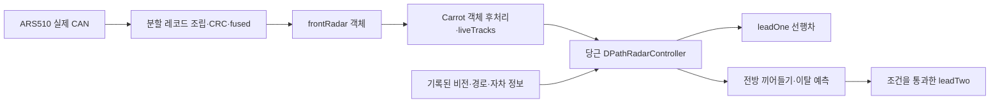

# RAV4 2022 전방·코너·당근레이더 구현 가능성

2026-10-12. 사용자 링크와 최신 원격 `carrot-wip`를 직접 확인했다. 원격과 작업 기준은 동일한 `0e4ee1bdbef3ad7284b136fddf31592e3f8a785f`이다.

## 결론

**ARS510 전방 트랙을 기존 당근레이더 처리 코어에 연결하는 것은 가능하다.** 선행차 거리·속도 매칭은 앞선 패치에서 이미 오프라인으로 연결했고, 이번에도 실제 CAN을 다시 재생해 확인했다. 당근레이더는 코너 객체가 없어도 전방 트랙만으로 끼어들기·앞차 이탈 예측 경로를 실행할 수 있다.

**Toyota 코너 레이더 객체 지원은 현재 자료로 구현할 근거가 부족하다.** 앞쪽 센서가 관측한 옆 차는 전방 객체이며, 별도의 측후방 코너 센서 객체와 구분해야 한다. Toyota 사각지대 경고 값이나 현대와 겹치는 CAN 주소로 거리·속도·객체 번호를 만들어서는 안 된다.

이번에는 가능성 조사·기존 코드 검사·실제 로그 재생만 수행했다. 이전 레이더·PCM 패치와 차량 설정·CarParams·Panda·CAN 송신 코드는 변경하지 않았다.

## 문서와 실제 코드의 차이

| 항목 | 사용자 문서 | 현재 실행 코드 |
|---|---|---|
| `CarrotRadarMode` | 0은 기존 radard, 1은 독립 당근레이더 선택 | manager는 `radard_dpath`를 OnRoad 프로세스로 등록한다. `CarrotRadarMode`로 선택하는 분기가 없고 원래 `controls/radard.py`도 없다. |
| `EnableRadarTracks=2` | 전방 트랙과 저속 SCC 매칭 | 선택값은 Hyundai에 적용한다. Toyota는 radarUnavailable=True이면−2, False이면1로 선택한다. |
| 코너0x430/0x440 | 코너 입력으로 구분·지원 설명 | 실제 Hyundai 파서는 해당 객체 해석이 미검증이라 실시간 입력을 차단한다. |

따라서 설명서의 숫자를 저장하는 것만으로 RAV4에서 같은 기능이 실행된다고 판단할 수 없다. 소스의 실행 대상과 수신 객체를 기준으로 확인해야 한다. 이는 최신 소스의 동작이며 사용 장치에 이 커밋이 설치돼 있다는 확인은 아니다.

근거: [문서](https://github.com/ajouatom/openpilot/blob/0e4ee1bdbef3ad7284b136fddf31592e3f8a785f/docs/user/ko/radar.md), [실행 프로세스](https://github.com/ajouatom/openpilot/blob/0e4ee1bdbef3ad7284b136fddf31592e3f8a785f/openpilot/system/manager/process_config.py#L162), [제조사별 모드 선택](https://github.com/ajouatom/openpilot/blob/0e4ee1bdbef3ad7284b136fddf31592e3f8a785f/openpilot/selfdrive/carrot/radar/__init__.py#L4), [0x430 입력 제한](https://github.com/ajouatom/openpilot/blob/0e4ee1bdbef3ad7284b136fddf31592e3f8a785f/opendbc_repo/opendbc/car/hyundai/radar_interface.py#L285).

## 재사용할 연결 구조

ARS510 전용 수신부만 따로 필요하며, 기존 `primary.py`, `controller.py`, `trajectory_cutin.py`, `trajectory_cutout.py`의 알고리즘은 재사용할 수 있다. 현재 `RadarInterface`에 현대 DBC를 넣는 방식은 적절하지 않다.

현재 오프라인 어댑터는 검증한 ARS 객체를 `radarSource=frontRadar`로 표시하고 `trackId`, `dRel`, `yRel`, `vRel`, `vLead`, `measured`, `aLead`, `jLead`, `yvRel`을 기존 형식에 전달한다. production 코어는 실측 포인트만 복사하고, 자차 속도와 상대속도로 대상의 지면 기준 속도를 다시 계산하며, 레이더와 카메라 시각을 맞춰 경로에 투영한다.

코너 객체가 없으면 motion 센서는 전방으로 유지된다. 코너가 있다면 제조사·메시지·품질을 검증한 별도 입력부가 필요하다. 코어가 코너 source를 받은 뒤 이를 motion 입력으로 선택하기 때문에 전방 ACC 보조 메시지를 코너라고 잘못 표시하면 처리 정책 자체가 달라진다.

근거: [당근 코어 구성·발행](https://github.com/ajouatom/openpilot/blob/0e4ee1bdbef3ad7284b136fddf31592e3f8a785f/openpilot/selfdrive/carrot/radar/radard_dpath.py#L86), [전방 motion 선택](https://github.com/ajouatom/openpilot/blob/0e4ee1bdbef3ad7284b136fddf31592e3f8a785f/openpilot/selfdrive/carrot/radar_motion/controller.py#L697), [실측 객체·속도 복사](https://github.com/ajouatom/openpilot/blob/0e4ee1bdbef3ad7284b136fddf31592e3f8a785f/openpilot/selfdrive/carrot/radar_motion/primary.py#L653).

## 기능별 판단

| 기능 | 판단 | 필요한 추가 조건 |
|---|---|---|
| 전방 객체·거리·상대속도 입력 | 오프라인 연결 확인 | 실제 ECU·펌웨어 출처, 좌우·속도 정확도 |
| 전방 비전 매칭 leadOne | 실제 CAN 재생으로 확인 | 실차 안전성·제어 활성 상황 |
| 당근 전방 CUT-IN/CUT-OUT | 코드 재사용 가능 | 이동·진입·이탈이 있는 실제 ARS 연속 이력과 영상 |
| 좌우 객체 표시 | 기존 코어 출력 경로 확인 | 영상과 좌우 좌표 대조 |
| 전방 먼 정지차·짧은 비전 소실의 강화 유지 | 현재 전 기능 보장 불가 | 해당 경로의 확인 상태와 원거리 품질 검증 |
| 저속 SCC 결합 모드2 | 별도 Toyota 구현·검증 필요 | 모드 선택 확장, OEM ACC 입력, 중복 객체·동일 센서 근거 처리 |
| Toyota 코너 레이더 | 현재 자료 부족 | 실제 코너 센서 객체 메시지·거리·종횡속도·ID·품질·주기 |
| 실제 가감속·PCS/AEB | 이번 검사 범위 밖 | 장치 빌드·ECU·Panda·순정 안전 기능 검증 |

당근 끼어들기 코어에 들어가는 모든 전방 객체가 곧 leadTwo나 제동 대상이 되지는 않는다. 실측 이력, 경로 진입, 물리적 연속성, 방향성, 앞차보다 가까운지 등의 조건을 통과해야 한다. 이를 완화하여 객체 수나 검출을 늘리는 변경은 이번에 하지 않았다.

## ARS510에서 그대로 가져올 수 없는 조건

- 원형 `fused`는 새 객체의 age60, 약3.6초까지 출력을 보류한다. 15m 밖의 비ACC 객체를 예상 경로±2.5m로 제한하고,60m 밖에서는 ACC 대응 객체만 낸다. 당근 코어가 빨리 예측할 수 있어도 수신부가 옆 차량 이력을 내주지 않으면 효과가 없다.
- 현재 ARS 어댑터의 `trackState`는 미확인 기본값0이다. 일부 원거리 정지차·확인 유지 경로는2 이상을 요구한다. ARS age·존재확률·이동 코드를 현대의 확인 상태2/3으로 임의 매핑해서는 안 된다.
- ARS의 횡속도 배율과 회전 보정, 미확인 횡속도를0으로 전달하는 기존 처리도 실제 좌우·진입 이력으로 검증해야 한다. 전방 코어는 위치 이력도 사용하므로 횡속도 미확인만으로 모든 전방 예측이 불가능한 것은 아니다.
- 원형 레코드 조립은 약27–49ms를 차지한다. 시작·완료 시각, ECU 자체 측정 지연, carState와 model의 동기화를 검증해야 하며 현대의50ms 값을 그대로 가정하지 않는다.

근거: [원형 fused 설정](https://github.com/ds-sebastian/ars510-radar/blob/673eb8e609e303feff2c15dd250592c383962156/ars510/interface.py#L157), [횡속도 처리](https://github.com/ds-sebastian/ars510-radar/blob/673eb8e609e303feff2c15dd250592c383962156/ars510/interface.py#L536), [확인 상태 검사](https://github.com/ajouatom/openpilot/blob/0e4ee1bdbef3ad7284b136fddf31592e3f8a785f/openpilot/selfdrive/carrot/radar_motion/primary.py#L1531).

## 코너 메시지를 재사용할 수 없는 이유

현대의 corner235는0x235–0x248의20개 주소가 모두32바이트일 때 감지한다. corner180도0x180–0x184의32바이트 메시지 조건이다. 첨부 Toyota의0x235·0x237은8바이트 전방 ACC 속도·위치 메시지다. 주소가 같아도 프로토콜과 센서 역할이 다르다.

Toyota의0x3F6 BSM은 좌우 인접·접근 경고이며 공개 파서는 좌우 경고 boolean으로만 전달한다. 현재 확인한 정의에는 객체 거리·속도·ID가 없다. 이 경고로 코너 객체를 만들어 기존 코어에 넣을 수 없다. 첨부 전체 CAN의 일부0x434·0x435 역시 주소만으로 코너로 판단하지 않았다.

근거: [현대 코너 그룹 감지](https://github.com/ajouatom/openpilot/blob/0e4ee1bdbef3ad7284b136fddf31592e3f8a785f/opendbc_repo/opendbc/car/hyundai/interface.py#L79), [Toyota BSM](https://github.com/ajouatom/openpilot/blob/0e4ee1bdbef3ad7284b136fddf31592e3f8a785f/opendbc_repo/opendbc/car/toyota/carstate.py#L176).

## 이번에 직접 실행한 결과

전방 매칭·motion·trajectory CUT-IN/CUT-OUT·SCC 정책·dPath 처리의 기존 코드 검사6개 파일을 실행하여 **814 passed,3.19초,실패·skip·warning0**을 확인했다. 합성 단위 사례의 통과이며 실차 CAN을 통한 끼어들기 성공 증거는 아니다. 지난 턴의559개 검사는 별도 수치다.

실제 첨부 CAN은 기존 어댑터·기존 Controller를 다시 실행하고 출력 관측만 추가했다. 객체·상태를 새로 만들거나 알고리즘을 바꾸지 않았다.

| 파일 | fused 객체 표본 | model 처리 | 레이더 leadOne 선택 | 레이더 leadTwo 선택 | CUT-IN 위험 출력 |
|---|---:|---:|---:|---:|---:|
| rlog.zst | 246 | 623 | 175 | 0 | 0 |
| rlog_06.zst | 117 | 1,019 | 0 | 0 | 0 |
| rlog_11.zst | 0 | 자료 부족 | 0 | 0 | 0 |
| rlog_12.zst | 6 | 1,150 | 0 | 0 | 0 |

모든 입력 source는frontRadar이고 motion 센서도front였다. model 시점마다 전달된 객체446개 표본의 `trackState`는 모두0이며 실측 표시는405개였다. 같은 객체가 여러 model 시점에 반복되므로446은 고유 객체 수나 fused 출력369와 같은 지표가 아니다. 좌·중앙·우 표시 출력도 실제 생성됐지만 ground truth 좌우 정확도 검증은 아니다.

실제 로그에서 CUT-IN/CUT-OUT 성공 사례는 확인하지 못했다. 없는 성공을 합성 객체로 보완하지 않았으며, 코너 데이터가 새로 확인됐다고 해석하지 않았다. 또한 원래 첨부 로그의 실제 제어 enabled/longActive는 모두False이므로 이 결과는 차량 감속 검증이 아니다.

## 구현 순서

1. 검증한 ARS510 객체를 전방 source로 전달하는 현재 오프라인 연결을 기준으로 유지한다.
2. 실제 앞차 이동·정지·좌우 진입·이탈·고속 원거리 로그로 선행차와 당근 예측을 따로 검증한다. 영상·ECU 식별·CAN·model·자차 정보의 시각을 함께 확보한다.
3. 확인 상태·횡속도·측정 지연의 근거를 확보한 부분만 매핑한다. 원형 fused 필터 변경은 별도 비교·회귀와 제어 영향 검토가 필요하다.
4. Toyota용 live RadarInterface 등록·감지·모드 선택은 ECU/PCS/AEB 조건이 해결된 뒤 검토한다. 현재 CP 플래그를 강제 변경하는 방식으로 활성화하지 않는다.
5. 코너 센서 원시 객체 프로토콜이 확인되면 별도 수신 어댑터와 ID 공간을 만들고 기존 당근의 front/corner 결합 코어를 사용한다. 코너 입력이 없으면 전방 전용 경로를 유지한다.

이번 결론은 **전방과 당근레이더 코어 재사용 가능, Toyota 코너 트랙·고급 확인 조건·실차 적용은 추가 검증 필요**이다.
